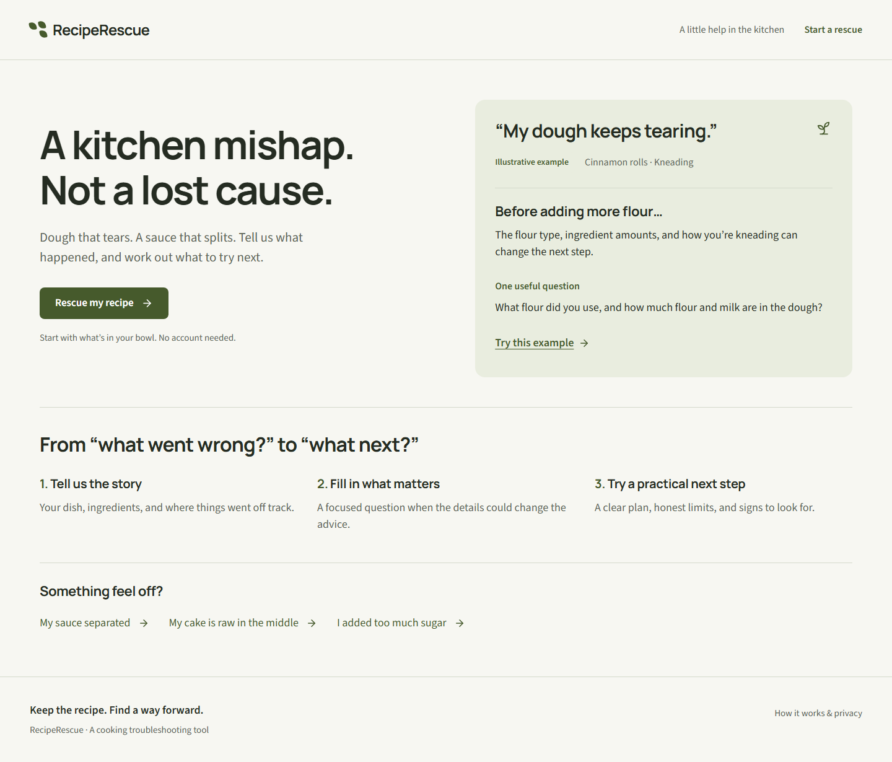

# RecipeRescue

**Fix the recipe you've already started.**

RecipeRescue is an open-source cooking troubleshooter for when things don't go according to plan. Tell it what you're making, what you've added, and what's going wrong. It can ask for missing details and suggest what to try next.

[Quick start](#quick-start) · [Self-hosting](docs/self-hosting.md) · [Contributing](CONTRIBUTING.md)



## What it does

Start with your ingredients, quantities, and cooking stage. Leave amounts blank when you don't know them. The recipe stays beside the guidance, so you can report what changed without entering everything again.

Guidance includes steps, things to check as you go, cautions, and tips for next time. Each rescue supports up to six follow-ups. You can connect an OpenAI-compatible model, enable photos with a compatible vision model, or try the built-in demo without an API key.

Food-safety concerns pause rescue instructions. The app cannot establish that food is safe to eat, and AI advice can be wrong.

## A dough that keeps tearing

The included cinnamon-roll demo shows the flow:

1. Describe the problem: “My dough feels soft but tears whenever I stretch it. I've already been kneading for a long time.” Add the ingredients and any amounts you know.
2. Get a focused question: what flour did you use, how much flour and milk went in, and did you knead by hand or in a mixer?
3. After a reply, see an example plan: keep the dough covered while reassessing, gently check a small piece, and report what changed. Each step includes an observation to look for and a caution.

This is a scripted, illustrative example, not a live AI response or a diagnosis of your dough. Demo mode makes no AI requests. Follow-ups show the same sample plan regardless of your answer.

## Quick start

Use Node.js 24 and npm; the minimum supported Node version is 22.12.

```sh
git clone https://github.com/GuramK1/reciperescue.git
cd reciperescue
npm ci
cp .env.example .env.local
npm run dev
```

In PowerShell, use `Copy-Item .env.example .env.local` for the copy step.

Open [127.0.0.1:3000](http://127.0.0.1:3000) and choose **Try this example**. The app starts in demo mode.

SQLite uses a native module. If installation needs a compiler, see [installation troubleshooting](docs/self-hosting.md#installation-troubleshooting), or run with Docker instead:

```sh
docker compose up --build
```

Run this from the cloned repository and open [localhost:3000](http://localhost:3000). Compose also defaults to demo mode and keeps SQLite data in the `rescue-data` volume.

## Connect an AI model

To troubleshoot your own recipes, configure an OpenAI-compatible model in `.env.local` and restart the server:

```dotenv
DEMO_MODE=false
AI_BASE_URL=https://your-provider.example/v1
AI_MODEL=your-model-id
AI_API_KEY=your-key
```

For Docker, put these settings in `.env` and recreate the container. Local models can use an empty API key. See the [configuration guide](docs/self-hosting.md#configuration) for endpoints, response formats, and timeouts.

Photos are disabled by default. Enable `AI_SUPPORTS_IMAGES=true` only with a model that accepts image input. Keys stay on the server; recipes, follow-up history, and submitted photos go to your chosen provider. The app does not save photos, but the provider's retention policy still applies.

Live AI providers have not yet been verified. Automated tests use mocked provider responses. Failed provider calls return an error; they never turn into demo advice.

## Self-hosting and development

This release is intended for local use or a trusted group. There are no accounts or saved-history screen. Public hosting requires access controls, shared usage limits, spending limits, and an HTTPS proxy; read the [deployment requirements](docs/self-hosting.md#deployment-limits) first.

Recipe text expires after 24 hours and is removed on the next database access. The [self-hosting guide](docs/self-hosting.md) covers persistent storage, backups, privacy, and running a production Node server.

- [Contributing](CONTRIBUTING.md) covers the code layout, local development, and test commands.
- [API documentation](docs/api.md) describes requests, responses, and upload limits.
- The [Figma file](https://www.figma.com/design/G6mfTbVKvfjjHKyRS1ydpq/RecipeRescue?node-id=2-19) contains the interface designs.

## Contributing

Bug reports are most useful with the steps to reproduce them and a sample recipe that contains no personal information. For code or documentation changes, start with [CONTRIBUTING.md](CONTRIBUTING.md). Keep changes focused and include checks for the behavior you change.

## License

[MIT](LICENSE), copyright (c) 2026 Guram Kikvidze. Font and icon licenses are included in [public/licenses](public/licenses).
